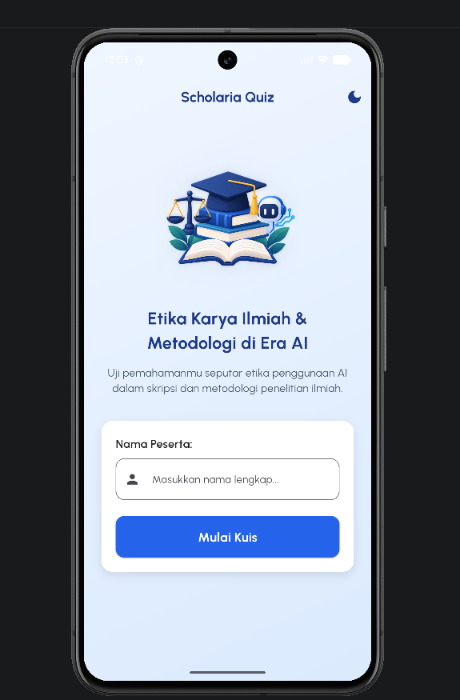
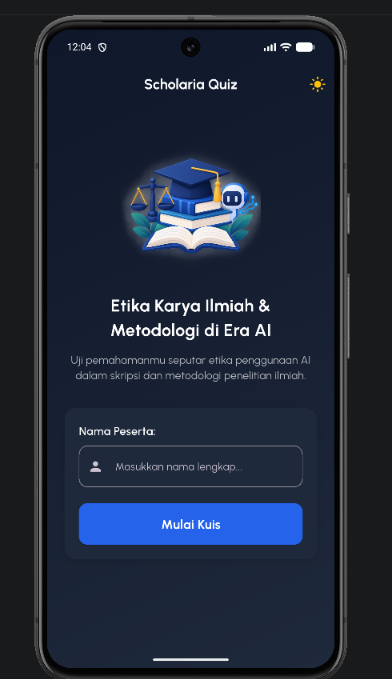
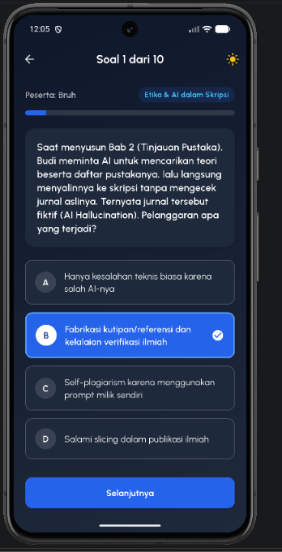
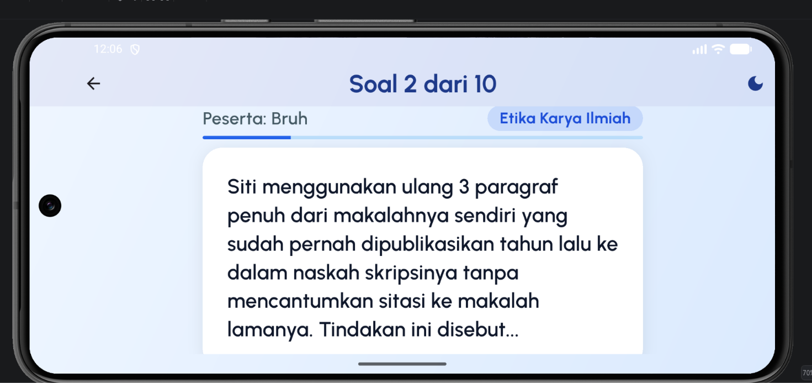
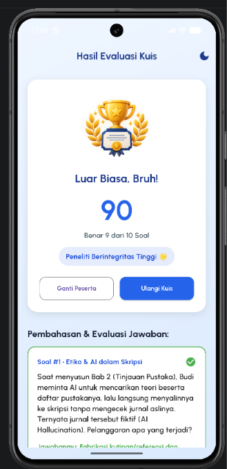
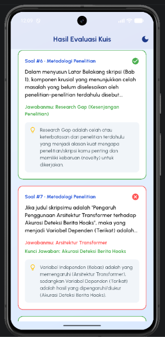

# 🎓 Scholaria Quiz — Aplikasi Kuis Etika Karya Ilmiah & Metodologi Penelitian

Proyek Ujian Tengah Semester (UTS) Praktikum Pemrograman Mobile  
**Program Studi S-1 Ilmu Komputer — Fasilkom-TI Universitas Sumatera Utara**

---

## 👤 Identitas Mahasiswa

| Keterangan | Detail                    |
| :--- |:--------------------------|
| **Nama** | Cristoval Pratama Siahaan |
| **NIM** | 241401057                 |
| **Lab Praktikum** | PM 5                      |

---

## 📱 Informasi Aplikasi

### 1. Nama Aplikasi
**Scholaria Quiz** (*Etika Karya Ilmiah & Metodologi di Era AI*)

### 2. Deskripsi Singkat Aplikasi
**Scholaria Quiz** adalah aplikasi kuis interaktif berbasis *mobile* (Flutter) yang dirancang untuk menguji dan mengedukasi mahasiswa mengenai **Etika Penulisan Karya Ilmiah (Skripsi)** di era *Generative AI* (seperti pencegahan *AI Hallucination*, *Self-Plagiarism*, *Falsifikasi Data*, dan *Patchwriting*) serta konsep dasar **Metodologi Penelitian** (*Research Gap*, variabel penelitian, *informed consent*, teknik *sampling*, hingga uji validitas dan reliabilitas).

### 3. Fitur-Fitur yang Tersedia
* **Input & Validasi Identitas Peserta:** Pengguna memasukkan nama sebelum memulai kuis dengan validasi input agar tidak boleh kosong.
* **10 Soal Studi Kasus & Metodologi:** Pertanyaan pilihan ganda dinamis yang dilengkapi label kategori topik dan *Progress Bar* interaktif.
* **Navigasi Soal Fleksibel:** Pengguna dapat berpindah ke soal berikutnya (*Selanjutnya*) maupun meninjau kembali soal sebelumnya (*Sebelumnya*) tanpa kehilangan jawaban yang sudah dipilih.
* **State Management Persisten (`Provider`):** Progres jawaban pengguna, indeks soal aktif, nama peserta, dan tema aplikasi tersimpan aman meskipun layar perangkat dirotasi (*Portrait* ke *Landscape*) atau berpindah antar-halaman.
* **Kalkulasi Skor, Predikat, & Pembahasan Ilmiah:** Menampilkan skor akhir (skala 0–100), predikat pemahaman etika ilmiah, evaluasi jawaban peserta beserta kunci jawaban yang benar, dan penjelasan edukatif di setiap butir soal.
* **Dual-Theme Mode (Light & Dark Mode):** Mendukung pergantian tema terang (*Light Mode*) dan gelap (*Dark Mode*) secara *real-time* di seluruh halaman aplikasi.
* **Adaptive & Responsive Design:** Ukuran seluruh elemen antarmuka bersifat dinamis mengikuti ukuran layar perangkat menggunakan `MediaQuery` dan `LayoutBuilder` sehingga bebas *overflow* pada berbagai ukuran layar maupun orientasi *landscape*.

---

## 🗂️ Struktur Folder Proyek

```text
lib/
├── config/
│   └── routes.dart            # Konfigurasi navigasi deklaratif terpusat (go_router)
├── data/
│   └── quiz_data.dart         # Data lokal (dummy data) 10 soal kuis & pembahasan ilmiah
├── models/
│   └── question_model.dart    # Blueprint model data pertanyaan (Question)
├── providers/
│   └── quiz_provider.dart     # State management (ChangeNotifier) untuk kuis & tema
├── screens/
│   ├── welcome_screen.dart    # Halaman awal input nama peserta (StatefulWidget)
│   ├── quiz_screen.dart       # Halaman pengerjaan kuis dinamis (StatelessWidget)
│   └── result_screen.dart     # Halaman skor akhir & evaluasi jawaban (StatelessWidget)
├── widgets/
│   ├── app_scaffold.dart      # Reusable widget kerangka halaman gradien & toggle tema
│   ├── option_card.dart       # Reusable widget kartu opsi pilihan ganda (A, B, C, D)
│   └── explanation_card.dart  # Reusable widget kartu pembahasan soal di halaman hasil
└── main.dart                  # Entry point aplikasi, ChangeNotifierProvider & ThemeData
```

---

## 📸 Dokumentasi Aplikasi

### 1. Screenshot Tiap Halaman Aplikasi

#### A. Halaman Awal (*Welcome Screen*)
| Light Mode | Dark Mode |
| :---: | :---: |
|  |  |

#### B. Halaman Kuis (*Quiz Screen* — Portrait & Landscape)
| Mode Portrait | Mode Landscape (Rotasi Layar) |
| :---: | :---: |
|  |  |

#### C. Halaman Skor Akhir & Pembahasan (*Result Screen*)
| Ringkasan Skor & Predikat | Evaluasi & Pembahasan Soal |
| :---: | :---: |
|  |  |

---

### 2. Link Mockup / Prototype Aplikasi
Desain *mockup* / *prototype* antarmuka aplikasi **Scholaria Quiz** dapat dilihat pada tautan berikut:
* 🔗 **Mockup Aplikasi (Figma):** [Lihat Mockup Scholaria Quiz](https://www.figma.com/design/CJk2keNg5Y0d2PlEfMK3Vl/Google-Pixel-8-Mockup--Community-?node-id=0-1&t=yovOGTIaJGbG4ITi-1)

---

### 3. Credit Sumber Aset
Seluruh aset visual dan tipografi yang digunakan di dalam proyek ini berasal dari sumber berlisensi gratis untuk penggunaan edukasi dan non-komersial:
1. **Custom Font (`Urbanist`):**
    * Diunduh dari [Google Fonts — Urbanist](https://fonts.google.com/specimen/Urbanist) (Dirancang oleh Corey Hu) dan aset Modul Praktikum Pemrograman Mobile IKLC Fasilkom-TI USU.
2. **Aset Ilustrasi & Gambar (`assets/images/`):**
    * `ethics_logo.png` & `result_badge.png`: Ilustrasi vektor edukasi dan lencana penghargaan hasil dari genereate Gemini AI.
3. **Ikon Antarmuka:**
    * Menggunakan *Material Design Icons* resmi bawaan Flutter SDK.